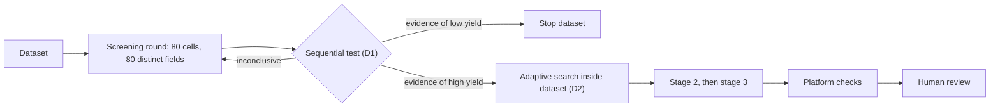
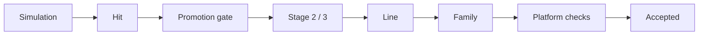
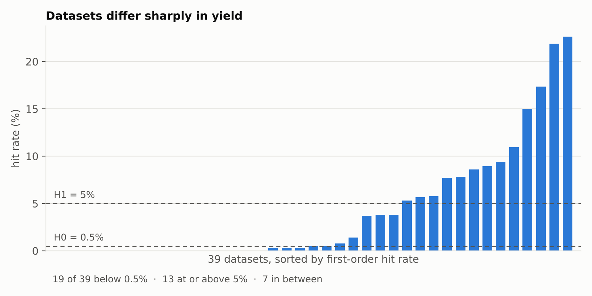
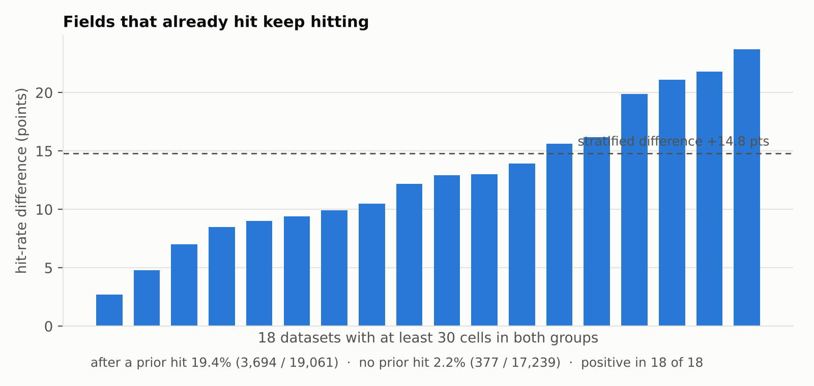
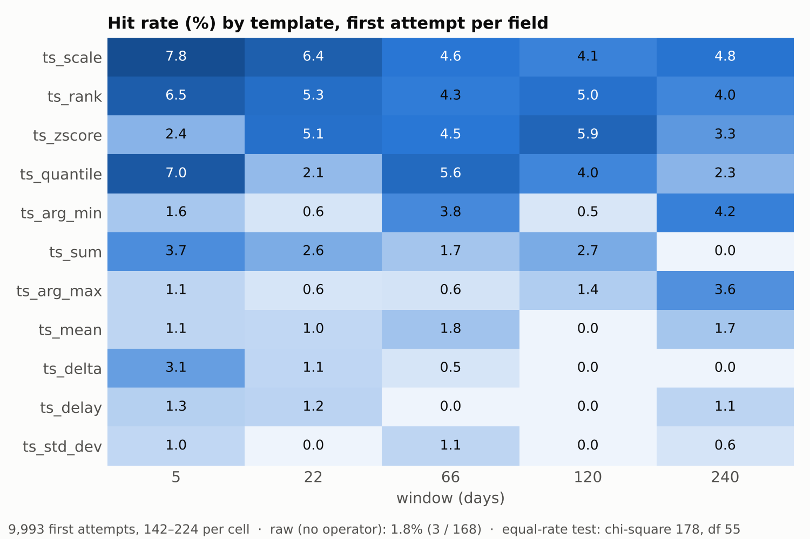
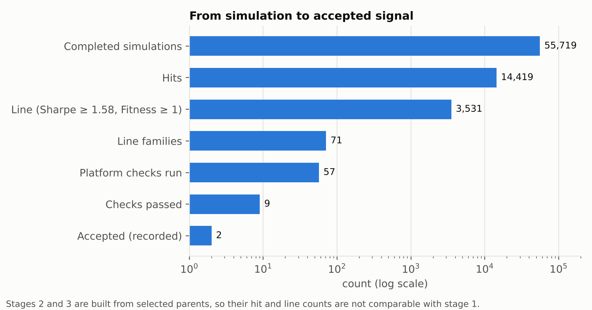

# Adaptive Alpha Scanner

### Sequential experimental design for allocating a fixed simulation budget in alpha discovery

**Design version v7 · data through 2026-10-31 · weekly log in [CHANGELOG.md](CHANGELOG.md)**

## Contents

1. [Problem](#1-problem)
2. [Definitions and outcomes](#2-definitions-and-outcomes)
3. [Design](#3-design)
4. [Assumptions](#4-assumptions)
5. [Evidence](#5-evidence)
6. [Results to date](#6-results-to-date)
7. [Limitations](#7-limitations)
8. [Repository and reproduction](#8-repository-and-reproduction)

---

## 1. Problem

### 1.1 Given

- **Simulator.** A formula (a data field passed through operators) is evaluated over a 10-year daily history. One call returns three statistics: Sharpe, Fitness and Turnover. One call is one *simulation* and costs one unit of budget.
- **Budget.** B = 4,000 simulations per day (the platform quota of 5,000 less 1,000 reserved for a separate pipeline).
- **Inventory.** 355 datasets and 81,336 fields in four regions (USA, EUR, GLB, AMR), each with field coverage of at least 40%.
- **Sampling frame.** 56 first-order templates per field. The first-order frame therefore holds 81,336 × 56 = **4,554,816 cells**, which is 1,139 days of budget before any higher-order search.

### 1.2 Unknown

- p<sub>d</sub>, the probability that a random cell of dataset *d* is a *hit* (defined in section 2). It differs by dataset.
- Which cells lead to a signal that passes the platform's submission checks.

### 1.3 Objective

Maximise the expected number of **independent, submittable signals per 1,000 simulations**.

### 1.4 Decisions

At every step the scanner chooses:

- **D1.** Which dataset receives the next simulations.
- **D2.** Which cells inside that dataset are simulated next.

### 1.5 Constraints

- B = 4,000 simulations per day.
- Platform limits: 10 simulations per request, 8 requests in flight.
- A dataset needs at least 500 active days to be submittable.
- A signal passes only if the platform's checks pass, chiefly a correlation limit against signals already submitted.

### 1.6 Why this is a statistics problem

1. p<sub>d</sub> is unknown and, in the data, spans two orders of magnitude (section 5, E1).
2. Cells of the same field are strongly dependent (section 5, E4), so simulations are not independent draws.
3. All 10 years are in-sample, so a passing formula is the maximum of many noisy draws.
4. Both errors are costly: stopping a good dataset loses it; keeping a poor one wastes budget.

### 1.7 Approach

Treat D1 as a **sequential hypothesis test** per dataset, and D2 as an **adaptive sampling rule** that exploits clustering of hits within fields. Survivors are escalated through staged search and only then sent to platform checks. Nothing is submitted automatically.



---

## 2. Definitions and outcomes

| Term | Definition |
|---|---|
| Dataset | A package of fields on the platform, fixed to one region, universe and delay. |
| Field | One column of a dataset. Vector fields enter in two forms (average and sum). |
| Template | One of 56 fixed formulas on a field: the field itself plus 11 time-series operators × 5 windows (5, 22, 66, 120, 240 days). Every field is first cleaned by `winsorize(ts_backfill(x, 120), std=4)`. |
| Cell | A (field, template) pair. One cell is one simulation. |
| Hit | \|Sharpe\| ≥ 1 and 1% ≤ Turnover ≤ 70%. The cheap screening event. |
| Line | Sharpe ≥ 1.58 and Fitness ≥ 1.0. A local pre-filter before asking the platform. |
| Family | Same dataset, same stage, same field. One representative (highest Sharpe) is sent to the platform. |
| Pass | Every platform submission check passes, including correlation with already-submitted signals. |
| Stage 1 / 2 / 3 | Stage 1: field × template. Stage 2: a selected stage-1 parent wrapped in a group operator. Stage 3: a selected stage-2 parent gated by an entry condition. |

**Fixed simulation settings** (identical for every simulation): delay 1; neutralization sub-industry; truncation 0.08; decay starts at 6 and is raised by a rule on turnover; pasteurization on. No part of the 10 years is held out.



**Noise baseline.** For a signal-free strategy the 10-year Sharpe estimate is approximately N(0, 1/√10), a standard deviation of 0.316. Then P(|Sharpe| ≥ 1) = P(|Z| ≥ 3.16) ≈ 0.157%. Simulations on signal-free data gave 0.15654%, used below as π<sub>noise</sub>. The value holds only for a 10-year history: for 5 years the same calculation gives about 2.5%.

---

## 3. Design

### 3.1 D1: dataset gate (Wald sequential probability ratio test)

Let p be a dataset's hit probability. Test

H<sub>0</sub>: p = 0.5% against H<sub>1</sub>: p = 5%, with α = 10% (keep a poor dataset) and β = 5% (stop a good one).

The log-likelihood score L starts at 0. Each simulation adds **+2.303** for a hit and **−0.0463** for a miss. L is evaluated after every round of 80. Boundaries: continue-and-keep if L ≥ **+2.251**, stop if L ≤ **−2.890**, otherwise sample another round. At the 1,600-simulation cap the dataset is kept if and only if L ≥ 0, that is at least 32 hits.

Direct consequences:

- Zero hits in the first 80 stops the dataset (80 × 0.0463 = 3.70 > 2.890).
- Three hits in the first 80 keep it (3 × 2.303 − 77 × 0.0463 = 3.34 > 2.251); two hits do not.
- The two hypotheses are equally likely to win at p\* = 0.0463 / (2.303 + 0.0463) = **1.97%**, the effective keep/stop line.

Operating characteristics (exact dynamic programme over the 20 looks, independent trials):

| True hit rate | Kept | Mean simulations |
|---:|---:|---:|
| 0.16% | 0.03% | 91 |
| 0.5% | 0.90% | 119 |
| 1.0% | 7.55% | 161 |
| 1.5% | 24.95% | 193 |
| 2.0% | 49.03% | 199 |
| 3.0% | 83.19% | 161 |
| 5.0% | 98.10% | 103 |
| 10% | 99.98% | 81 |

Realised error rates (0.90% at H<sub>0</sub>, 1.90% at H<sub>1</sub>) are far below the nominal 10% and 5% because looks are discrete and the boundaries conservative. These figures assume independent trials; with dependence the true rates are unknown (assumption 6).

### 3.2 D2: allocation inside a dataset

- **Screening rounds.** Each round draws 80 *different* fields and one random template per field. Distinct fields limit dependence inside the round.
- **Hit-field priority.** Once a field has produced a hit, its remaining templates are queued first. Untested cells are never pruned, only reordered.
- **Why.** Cells of a field that already hit hit again 19.4% of the time versus 2.2% for other fields (E3).

### 3.3 Staged search

| Stage | Cap per visit | Construction | Promotion into the next stage |
|---|---:|---|---|
| 1 | 2,000 | field × template | \|Sharpe\| ≥ 1.2, \|Fitness\| ≥ 0.7, more than 100 positions; best 100; at most 5 per field |
| 2 | 1,000 | stage-1 parent × group wrapper | \|Sharpe\| ≥ 1.3, \|Fitness\| ≥ 0.8; best 200 |
| 3 | 1,000 | stage-2 parent × entry condition | none; results go to line check |

Negative signals are flipped before promotion. The caps sum to 4,000, one day's budget. Gate values and the 2,000 / 1,000 / 1,000 split are design choices inherited from earlier versions, not optima (assumption 14).

### 3.4 Luck share

For n simulated cells and h observed hits, luck share = n · π<sub>noise</sub> / h. This is a plug-in upper bound on the share of hits attributable to noise under independent noise. It is not a multiplicity-corrected q-value and ignores dependence.

### 3.5 Submission stage

Each family representative is sent to the platform for its submission checks. A pass is valid only until the set of submitted signals changes, because correlation is measured against that set; after any submission passes are re-checked. A category cell is treated as saturated once at least 3 accepted signals exist and its remaining datasets are skipped. A separate shortlist for a theme-specific program (Power Pool) applies its own numeric filters. Final submission is always a human action.

### 3.6 Parameters and their origin

| Parameter | Value | Origin | Reason |
|---|---|---|---|
| Daily budget | 4,000 | Platform quota 5,000 less 1,000 for a separate pipeline | Fixed by allocation |
| Round | 80 cells, 80 distinct fields | 8 requests × 10 simulations (platform limits) | One look per full round; distinct fields limit dependence |
| H<sub>0</sub> | 0.5% | Measured: datasets stopped by the test hit at 0.22% (13 / 5,886) | About 3 × the noise rate of 0.157% |
| H<sub>1</sub> | 5% | Measured: 13 of 39 datasets at or above 5% (5.3% to 22.6%) | Rounded down from the fitted high group |
| α, β | 10%, 5% | Design choice | Stopping a good dataset costs more than keeping a poor one |
| Cap per dataset | 1,600 | Budget guard | No statistical derivation (assumption 11) |
| Stage caps | 2,000 / 1,000 / 1,000 | Budget guard | Design choice (assumption 14) |
| Stage gates | 1.2 / 0.7 and 1.3 / 0.8 | Inherited | Not optimised (assumption 14) |
| Line | Sharpe ≥ 1.58, Fitness ≥ 1.0 | 1.58 is the platform's CLUSTER_TEST limit | Local pre-filter; the real Sharpe limit varies by region |
| Coverage floor | 40% | Design choice | Excludes sparse fields (smallest inventory value 41.1%) |
| Minimum active days | 500 | Platform rule, measured 2026-10-14 | Fewer cannot be submitted |
| Check wait | 180 s | Budget guard | A check not ready is retried the next day |
| Saturation | 3 accepted per cell | Design choice | Avoids searching an occupied cell |

---

## 4. Assumptions

Every assumption the conclusions rest on. *Relied on by* names the design element; *Evidence* is what the logs show on 2026-10-31. Status: **Supported**, **Challenged**, **Open** (not yet tested), **Known bias**, **Boundary** (true by design), **Handled** (in code).

### A. Sampling frame

| # | Assumption | Relied on by | If wrong | Evidence | Status |
|---|---|---|---|---|---|
| 1 | The 56 templates and the fixed field wrapper (back-fill, winsorize at 4 standard deviations) represent whether a field carries signal | D2, frame | A signal expressed another way is never seen | Hit rate by template ranges from 0% to 7.8%; equal-rate test chi-square 178 against a 5% critical value of about 72 (df 55) (E5). Composition matters; no held-out random template draw yet | Open |
| 2 | In screening, one random template per field measures the dataset's average quality | D1 | A dataset where only one template works is under-rated | Templates differ (E5), so a single draw is noisy but unbiased when the template is random. Field × template interaction not yet separated | Open |
| 3 | The relevant population is fields with coverage of at least 40%, vector fields split into two forms | Inventory | Other fields lie outside every conclusion | Inventory minimum coverage is 41.1% | Boundary |
| 4 | Screening rounds are random and unbiased; later adaptive rounds are not | Rate estimation | Rates from adaptive rounds are inflated | About 11% of first-order records were random on 2026-10-27. The phase is not logged, so this cannot be re-measured | Known bias |

### B. Dataset model and noise

| # | Assumption | Relied on by | If wrong | Evidence | Status |
|---|---|---|---|---|---|
| 5 | A dataset's hit rate takes one of two values (0.5% or 5%) | D1 hypotheses | Real rates are continuous | Of 39 datasets with at least 80 first-order simulations: 19 below 0.5%, 4 in 0.5%–2%, 3 in 2%–5%, 8 in 5%–10%, 5 at or above 10%. The middle (0.5%–5%) holds 7 of 39 (E1) | Partly supported |
| 6 | Simulations are independent given the dataset | D1 error rates | Effective sample is smaller; true error rates differ from nominal | Same-field Sharpe correlation between adjacent windows is 0.89 to 0.93 (E4) | Challenged |
| 7 | A dataset's hit rate is constant across visits and time | D1 | Stale verdicts | Repeat visits not compared | Open |
| 8 | A hit indicates real signal | D1, D2 | Hits are noise or unusable | Hits are not noise (9.8% against 0.157%; luck share 1.6%) but only 1.6% of stage-1 hits reach the line (E8) | Weak |
| 9 | The noise hit rate (0.15654%) is the same for every region, universe, history length and template | Luck share, H<sub>0</sub> | Luck share wrong by a large factor (about 16 × for 5 years) | Sharpe standard deviation in 18 low-hit datasets is 0.25 to 0.38 (median 0.32) against 0.316 expected (E6). Not tested by region | Open |
| 10 | Errored and failed simulations are missing at random | All rates | Rates biased if failures concentrate in some fields | 3.8% errored, 0.8% failed of 58,567 records; concentration by field or template not tested | Open |

### C. Stopping rule

| # | Assumption | Relied on by | If wrong | Evidence | Status |
|---|---|---|---|---|---|
| 11 | A 1,600 cap and a look every 80 are adequate | D1 cost | Cost per dataset mis-sized | Datasets stopped by the test stopped after a median of 240 simulations (range 80 to 793); none reached the cap. No derivation of 1,600 | Open |
| 12 | At the cap, keep if and only if at least 32 hits | D1 | Arbitrary tie-break | Replaying the test on all 39 datasets with at least 80 simulations gives 26 stops and 13 keeps; no dataset was undecided, so the tie-break has not been used | Open |
| 13 | Datasets stopped by the test contain nothing worth finding | D1 | False-negative rate unknown | 21 datasets stopped by the test: 13 hits in 5,886 simulations (0.22%), 2 line records. No re-test of stopped datasets | Open |

### D. Staged search

| # | Assumption | Relied on by | If wrong | Evidence | Status |
|---|---|---|---|---|---|
| 14 | A stage-1 hit predicts improvement under stage-2 and stage-3 variants; the gate values and caps are adequate | Staging | Wasted budget or lost candidates | Stage 2: 67.0% hits, 19.9% line. Stage 3: 84.3% hits, 32.6% line. Both are built from selected parents (see 15). Gates inherited, not optimised | Open |
| 15 | Later-stage hit rates reflect true quality | Interpretation | They are inflated by selection | Selection bias (winner's curse) is built into the construction | Known bias |
| 16 | The group and entry-condition variants cover the useful space | Staging | Unlisted variants are never tried | By design | Boundary |
| 17 | Repeated in-sample selection does not overfit | All | Candidates degrade out of sample | No hold-out beyond platform checks | Known bias |
| 18 | The same expression always returns the same result | Caching, resume | Cached and repeated results disagree | Not re-run on a sample | Open |
| 19 | The code implements this document | All | Silent divergence | On 2026-10-27 the rewrite matched the previous version on all 9 real-data comparisons; 70 private unit tests exist, 6 of which currently fail because they assume a setting switched off on 2026-10-31 (see CHANGELOG). The version has run on the platform since 2026-10-28 | Partly supported |

### E. Submission stage

| # | Assumption | Relied on by | If wrong | Evidence | Status |
|---|---|---|---|---|---|
| 20 | Screening thresholds on Sharpe and Fitness predict passing the platform checks | Line | Good candidates dropped, or poor ones sent | 71 line families led to 57 checks and 9 passes (E9). Conversion by threshold not estimated | Open |
| 21 | Signals of the same field, stage and dataset share a check outcome, so one representative suffices | Family | A passable candidate is skipped | Non-representatives not spot-checked | Open |
| 22 | A pass is valid only while the set of submitted signals is unchanged | Re-check | A stale pass is acted on | Passes expire after any submission and are re-checked | Handled |
| 23 | Correlation with submitted signals, not Sharpe, is the binding constraint on submission | Search targeting | Effort aimed at the wrong target | 36 of 48 failed checks (75%) include a correlation failure (E9) | Supported |
| 24 | A category cell is saturated once enough accepted signals exist | Queue | Skipped cells hold unsubmitted value | Heuristic; not compared with realised acceptance | Open |
| 25 | The program's end conditions and eligibility rules are as understood | Queue | Wasted search or a wrong stop | Rules re-read at each review | Open |
| 26 | The daily quota and its day boundary are stable and counted as assumed | Budget | Over- or under-spend | Day boundary 21:00 Pacific; counts reconciled against platform notices | Monitored |
| 27 | Check results are available within the fixed wait | Checks | A false "not ready" | Retry log not yet analysed | Open |
| 28 | Placeholder descriptions are accepted by the platform | Checks | Submission blocked | Not verified separately | Open |

---

## 5. Evidence

Each row ties an observation to the design choice it supports or challenges. All values are recomputed from the run logs on 2026-10-31. They support the allocation method; they are not claims about the performance of any individual signal.

| # | Design element | Observation | n | Reading |
|---|---|---|---|---|
| E1 | D1: datasets differ in yield | Hit rate of 39 datasets: 19 below 0.5%, 13 at or above 5%; median 0.5%, mean 4.2%, pooled 9.8% | 39 datasets | Supports a per-dataset test. Pooled rate is 2.4 × the equal-allocation mean, a mix of D1 and D2 effects |
| E2 | D1: early stopping | 21 datasets stopped by the test: 5.9 thousand simulations spent against an estimated 32.6 thousand for a full first-order visit (about 82% saved). 13 hits in 5,886 simulations (0.22%), 2 line records | 21 datasets | Little appears lost. The saving is a counterfactual that assumes each full visit would have run `min(2,000, cells)` simulations |
| E3 | D2: hit-field priority | Cells whose field had already hit: 19.4% (3,694 / 19,061). Other cells: 2.2% (377 / 17,239). Stratified difference +14.8 points; positive in 18 of 18 datasets | 18 datasets | Supports D2. Association only: sampling after a hit is adaptive |
| E4 | Dependence | Same-field Sharpe correlation between adjacent windows: 0.889 (5 vs 22), 0.910 (22 vs 66), 0.911 (66 vs 120), 0.925 (120 vs 240) | 4,686 to 4,704 pairs each | Cells of a field are not independent; motivates distinct-field rounds and weakens nominal error rates |
| E5 | Frame: templates | Hit rate by operator, first attempt per field: scale 5.6%, rank 5.0%, zscore 4.3%, quantile 4.2%, sum 2.2%, arg_min 2.1%, raw 1.8%, arg_max 1.5%, mean 1.1%, delta 1.0%, delay 0.7%, std_dev 0.6%. By window: 3.3% at 5 days, 2.1% to 2.6% otherwise | 9,993 first attempts | The 56 templates are not exchangeable (chi-square 178, df 55). First attempts are random probes, so adaptive reordering does not bias this |
| E6 | Noise scale | Sharpe standard deviation across cells of datasets with hit rate at most 0.6%: 0.25 to 0.38, median 0.32 | 18 datasets | Consistent with 0.316 from 1/√10 |
| E7 | Luck share | 41,622 stage-1 cells × 0.15654% = 65 expected noise hits against 4,079 observed | 41,622 cells | Hits are not noise: luck share 1.6% |
| E8 | Hit as a proxy | Stage 1: 4,079 hits, 65 lines (1.6% of hits). Stage 2: 5,963 hits, 1,774 lines. Stage 3: 4,377 hits, 1,692 lines | 55,719 cells | A hit rarely reaches the line; later stages are built from selected parents and are not comparable |
| E9 | Bottleneck | 57 platform checks, 9 passed. Of 48 failures, 36 include a correlation failure (75%) | 57 checks | Correlation with submitted signals, not signal quality, limits submission |









---

## 6. Results to date

Records from 2026-10-14 to 2026-10-31 14:41 Pacific. 58,567 records: 95.4% completed, 3.8% errored, 0.8% failed. Of the 419 queue entries, 40 have first-order records (9.5%); no conclusion extends to the others.

### 6.1 Funnel by stage

| Stage | Completed cells | Hits | Hit rate | Lines | Line rate | Line families |
|---|---:|---:|---:|---:|---:|---:|
| 1 | 41,622 | 4,079 | 9.8% | 65 | 0.16% | 18 |
| 2 | 8,907 | 5,963 | 66.9% | 1,774 | 19.9% | 31 |
| 3 | 5,190 | 4,377 | 84.3% | 1,692 | 32.6% | 22 |

Stages 2 and 3 are built from selected parents; their rates are not comparable with stage 1.

### 6.2 Dataset outcomes

| State | Datasets |
|---|---:|
| Stopped by the sequential test | 21 |
| Stopped by the 500-active-day rule | 2 |
| Paused (resume next visit) | 9 |
| Quota ran out (resume next visit) | 2 |
| Fully searched | 4 |
| In progress | 2 |

### 6.3 Yield by region and category

First-order hit rate, datasets with at least 80 first-order simulations.

| Region | Category | Datasets | First-order simulations | Hit rate |
|---|---|---:|---:|---:|
| GLB | model | 6 | 8,076 | 16.0% |
| USA | model | 3 | 2,470 | 14.0% |
| EUR | analyst | 6 | 10,439 | 13.7% |
| EUR | model | 3 | 5,920 | 7.3% |
| USA | analyst | 3 | 5,257 | 6.3% |
| GLB | unlisted | 1 | 728 | 5.8% |
| USA | news | 3 | 4,399 | 4.1% |
| AMR | model | 2 | 1,216 | 1.8% |
| GLB | analyst | 3 | 836 | 0.2% |
| EUR | news | 3 | 800 | 0.1% |
| AMR | analyst | 2 | 478 | 0.0% |
| AMR | news | 2 | 470 | 0.0% |
| GLB | news | 2 | 500 | 0.0% |

Yield follows region and category together, not category alone (assumption 5, E1).

### 6.4 Daily record

Completed cells by stage, and hits and lines among them. The last row is partial.

| Date | Stage 1 | Stage 2 | Stage 3 | Hits | Lines |
|---|---:|---:|---:|---:|---:|
| 10-22 | 740 | 0 | 0 | 3 | 0 |
| 10-23 | 3,957 | 0 | 0 | 113 | 2 |
| 10-24 | 2,591 | 990 | 960 | 1,364 | 53 |
| 10-25 | 2,525 | 800 | 0 | 982 | 279 |
| 10-26 | 2,794 | 1,000 | 600 | 1,540 | 427 |
| 10-27 | 1,159 | 140 | 80 | 169 | 5 |
| 10-28 | 1,545 | 286 | 0 | 423 | 0 |
| 10-29 | 3,546 | 0 | 0 | 693 | 0 |
| 10-30 | 3,305 | 0 | 0 | 518 | 0 |
| 10-31 | 1,360 | 0 | 0 | 142 | 0 |

From 10-28 almost all simulations were first order, because regions of a theme-specific shortlist program (Power Pool) were scanned first-order only; that scan was switched off on 10-31. Stage-1 cells reach the line at 0.16%, so no lines on those days is consistent with the design and does not indicate a change in signal quality.

### 6.5 Submission stage

| Item | Count |
|---|---:|
| Platform checks run (2026-10-16 to 2026-10-30) | 57 |
| Passed | 9 |
| Failed | 48 |
| Failures including a correlation failure | 36 |
| Failures including an in-sample Sharpe ladder failure | 7 |
| Failures because the signal was already submitted | 6 |
| Failures including a low 2-year Sharpe | 2 |
| Accepted signals recorded in the pyramid log | 2 |

A check can fail for more than one reason. Regular candidates awaiting review: 6. Theme shortlist awaiting review: 135 (GLB 79, USA 41, EUR 15).

---

## 7. Limitations

- **Coverage.** 40 of 419 queue entries have first-order records (9.5%). Nothing generalises to the rest.
- **No control arm.** The allocation was never compared with a uniform or random allocation, so the saving in E2 and the 2.4 × in E1 are estimates from the scanner's own data, not causal effects.
- **Adaptive sampling.** Rates after a field's first hit, and all stage-2 and stage-3 rates, come from policy-chosen cells and are inflated by selection.
- **In-sample.** All 10 years are in-sample. Platform historical partitions and sub-universe checks are not true out-of-sample evidence.
- **Dependence.** Within-field sampling reduces dependence during screening but does not remove it; nominal error rates are optimistic.
- **Binary hit.** The hit abstraction discards the continuous information in Sharpe, turnover and other diagnostics.
- **Noise model.** The 1/√10 scale holds for a 10-year history; real return series are autocorrelated and fat-tailed.
- **Phase not logged.** Whether a cell came from a random round or an adaptive round is not recorded, so assumption 4 cannot be re-measured.
- **Scope.** This repository demonstrates research design and orchestration, not a live, predictive or tradable system.

Real field names, expressions, identifiers, credentials, account details, endpoints, raw logs and private research notes are excluded. Authenticated simulation and final submission require a private adapter and a human action.

---

## 8. Repository and reproduction

The public package separates statistical policy from platform execution:

- `statistics.py` implements the sequential test and the exploratory luck-share diagnostic.
- `sampling.py` selects distinct-field screening batches and prioritises remaining cells of hit fields.
- `formula_factory.py` creates sanitised first-, second- and third-order experiment specifications.
- `pipeline.py` tracks stage budgets, skips completed experiments and supports pause and resume from prior results.
- `platform_adapter.py` defines the execution boundary and retry handling, with no authentication and no endpoints.
- `tests/` checks stopping boundaries, distinct-field batches, hit-field priority, budget caps, retry and resume behaviour (13 tests).

```text
alpha-scanner/
├── README.md          this document
├── CHANGELOG.md       weekly log, newest first
├── figures/           the four figures above
├── scanner/           statistics, sampling, formula_factory, pipeline, platform_adapter
├── tests/             13 deterministic tests
└── pyproject.toml
```

Run the tests with `python -m pytest`. Completed experiment keys and sanitised result records can be persisted by the caller and supplied to the next visit. Final platform checks and submission remain manual by design.
