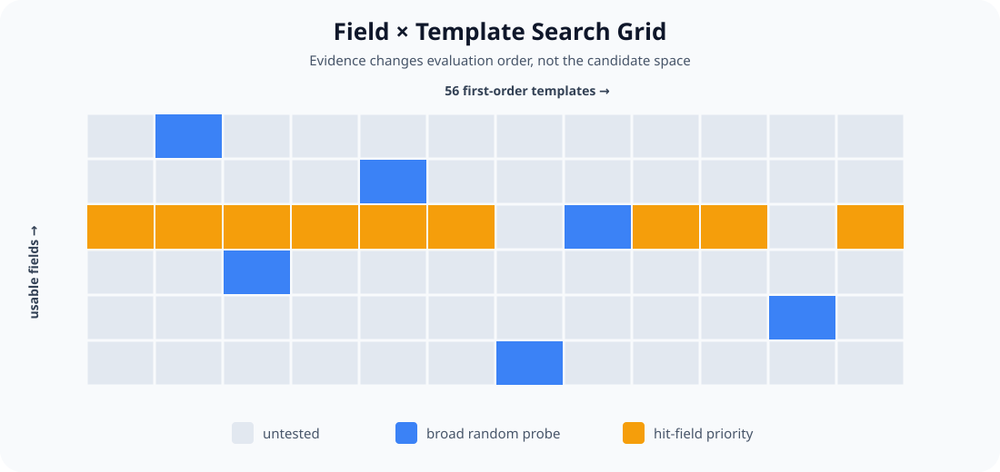

# Adaptive Alpha Scanner

### Statistical Experimental Design for Large-Scale Alpha Discovery

Large-scale alpha discovery creates a structured search problem: each dataset contains many usable fields, and each field can be evaluated through a fixed library of first-order templates. The search space grows rapidly while simulation capacity remains fixed.

I designed the scanner as a **budget-constrained sequential statistical experiment**, not a brute-force formula enumerator. Statistical evidence determines whether a dataset deserves more budget; adaptive sampling determines where the next simulations should be concentrated.

| Research design | Value |
|---|---:|
| First-order templates per field | **56** |
| Screening batch | **80 simulations** |
| Daily simulation budget | **4,000** |
| Dataset screening | **Wald SPRT** |

## Table of Contents

1. [Overview](#overview)
2. [Search-Space Formulation](#search-space-formulation)
3. [Statistical Design](#statistical-design)
4. [Adaptive Sampling](#adaptive-sampling)
5. [Results & Evidence](#results--evidence)
6. [Representative Case](#representative-case)
7. [System Design](#system-design)
8. [Repository Structure](#repository-structure)
9. [Limitations / Disclosure Boundary](#limitations--disclosure-boundary)
10. [Documentation and Progress](#documentation-and-progress)

## Overview

The central question is not how to generate more formulas. It is:

> **How should a fixed simulation budget be allocated across a large, heterogeneous, correlated search space?**

The objective is to maximize credible discoveries per 1,000 simulations while attaching explicit statistical error rates to allocation decisions. Dataset screening removes clearly low-yield regions early. Within retained datasets, field-level evidence changes evaluation order without deleting unexplored candidates. Higher-order search is bounded by stage-specific budgets.

This repository is a sanitized, platform-neutral reference implementation. It preserves the statistical decisions and orchestration while excluding private research content and authenticated execution.

## Search-Space Formulation

For a dataset with $n$ usable fields and $m=56$ templates, the first-order search space is

$$
n \times 56.
$$

One cell is one field-template formula requiring one backtest simulation.

| Dataset scale | First-order candidate space |
|---|---:|
| 200 fields × 56 templates | **11,200 simulations** |
| 6,650 fields × 56 templates | **372,400 simulations** |

At 4,000 simulations per day, the largest observed dataset would require about **93 days** of budget before any higher-order search.



- **Gray:** untested cells
- **Blue:** broad random probes across different fields
- **Orange:** remaining templates moved forward after that field produces a hit

The grid is heterogeneous: dataset hit rates differ, signal clusters by field, and related cells are dependent. This motivates two separate decisions: whether a dataset merits more budget, and where the next simulation should be spent inside it.

## Statistical Design

### Binary screening outcome

A first-order result is a hit when

$$
|\mathrm{Sharpe}| \ge 1
\qquad\text{and}\qquad
1\% \le \mathrm{Turnover} \le 70\%.
$$

Let $p$ denote the dataset's unknown hit probability. The dataset gate compares

$$
H_0:p=0.5\%
\qquad\text{vs.}\qquad
H_1:p=5.0\%.
$$

Define $\alpha=10\%$ as the maximum probability of falsely retaining a bad dataset, and $\beta=5\%$ as the maximum probability of falsely abandoning a good dataset. The Wald boundaries are

$$
A=\ln\left(\frac{1-\beta}{\alpha}\right)
=\ln\left(\frac{0.95}{0.10}\right)
\approx +2.25,
$$

$$
B=\ln\left(\frac{\beta}{1-\alpha}\right)
=\ln\left(\frac{0.05}{0.90}\right)
\approx -2.89.
$$

The log-likelihood-ratio increments are

$$
\Delta L_{\mathrm{hit}}=\ln\left(\frac{0.05}{0.005}\right)=+2.303,
$$

$$
\Delta L_{\mathrm{miss}}=\ln\left(\frac{0.95}{0.995}\right)=-0.0463.
$$

Therefore $L\ge A$ retains the dataset and $L\le B$ abandons it. Every screening round samples **80 different fields**, with one random template per field, to reduce within-round dependence. A zero-hit dataset stops at the first look (**80 simulations**). The two hypotheses are equally likely to win at a hit rate of about **1.97%**, so that is the effective retain/abandon line. If neither boundary is reached by 1,600 simulations, a non-negative score continues and a negative score abandons. The cap is a pragmatic bound, not a derived quantity (see [docs/ASSUMPTIONS.md](docs/ASSUMPTIONS.md)).

### Operating-characteristic check

Exact dynamic-programming evaluation of the decision rule (looks every 80 simulations, cap 1,600, independent Bernoulli outcomes):

| True hit rate | Retained | Mean simulations |
|---:|---:|---:|
| 0.16% | 0.03% | 91 |
| 0.5% | 0.9% | 119 |
| 1.0% | 7.6% | 161 |
| 1.5% | 25% | 193 |
| 2.0% | 49% | 199 |
| 3.0% | 83% | 161 |
| 5.0% | 98.1% | 103 |
| 10% | 99.98% | 81 |

The realised error rates (0.9% false retention at the null, 1.9% false abandonment at the alternative) sit well below the nominal 10% and 5% because looks are discrete (every 80) and the boundaries are conservative. These figures assume independent trials; field-level dependence makes the effective sample smaller (see Limitations).

Clearly weak and clearly rich datasets resolve quickly; datasets near the practical boundary require more evidence.

## Adaptive Sampling

After dataset screening, allocation adapts at the field level. The scanner **does not prune** unexplored candidates; it only reorders them.

| Evidence state | Subsequent observed hit rate |
|---|---:|
| Field already produced a hit | **18.1%** |
| Field still unproven | **1.3%–3.1%** |

Same-field variants across adjacent windows had Sharpe correlations of **0.70–0.87**. By contrast, the first test's $|\mathrm{Sharpe}|$ had only about **0.2** cross-template predictive correlation. The useful state variable is therefore whether the field has produced a hit, not the exact magnitude of its first result.

The policy is simple:

1. probe broadly across unproven fields;
2. after a field hits, move its remaining cells forward;
3. continue sampling the rest of the grid rather than deleting it.

### Multi-stage search

| Stage | Per-visit cap | Construction |
|---|---:|---|
| First order | **2,000** | field × first-order template |
| Second order | **1,000** | selected parent × group wrapper |
| Third order | **1,000** | selected parent × conditional `trade_when` variant |

First-order promotion requires $|\mathrm{Sharpe}|\ge1.2$, $|\mathrm{Fitness}|\ge0.7$, and more than 100 positions. Candidates are decay-adjusted, negative signals are flipped before comparison, and the top 100 are retained with at most five per field. Higher-order wrapper names remain abstract in the public implementation.

## Results & Evidence

The evidence below supports the allocation method; it is not a claim about the performance of an individual alpha.

- Across **35 datasets with at least 80 logged simulations**, the first random round of 80 gave **22** datasets with zero hits and **5** with four or more. A two-point mixture fitted to those counts puts about **25%** of datasets in a high-yield group (hit rate ≈ 6%) and the rest at or below about 0.5%; with only 35 datasets the weight is imprecise. Replaying the stopping rule over all 36 datasets with first-order logs gives 25 abandon, 10 retain, 1 still undecided.
- This fit is the basis for the current H0/H1 values; it will be re-estimated as coverage grows (see [docs/PROGRESS.md](docs/PROGRESS.md)).
- Field-level priority (below) comes from the earlier v6 analysis and has not yet been re-estimated under the current design.
- Remaining cells from a field that had hit yielded **18.1%**, versus **1.3%–3.1%** for unproven fields.

For a 10-year horizon, the noise-scale approximation is

$$
\sigma_{\mathrm{Sharpe}}\approx\frac{1}{\sqrt{10}}\approx0.316.
$$

Near-noise datasets showed empirical Sharpe dispersion of **0.28–0.33**, consistent with that scale. An exploratory false-discovery diagnostic is

$$
\widehat{\mathrm{FDR}}
=\frac{N_{\mathrm{simulations}}\times0.16\%}{N_{\mathrm{observed\ hits}}}.
$$

This ratio is a scale diagnostic, not a formal multiple-testing correction.

## Representative Case

### USA / Option-Chart Model — v6

One recorded 4,000-simulation visit moved from broad exploration across **380 fields** to targeted higher-order refinement across **7 surviving field families**.

| Stage | Candidate space | Executed simulations | Hits | Hit rate | Promotion-qualified |
|---|---:|---:|---:|---:|---:|
| First order | **24,584** | **2,000** | **347** | **17.35%** | **36** |
| Second order | **2,178** | **1,000** | **759** | **75.9%** | **216** |
| Third order | **1,320** | **1,000** | **825** | **82.5%** | — |

The first-order stage touched 380 unique fields; its 36 promotion-qualified results represented 13 fields. The second- and third-order stages each covered 7 selected field families.

**Candidate space is not executed budget.** The table reports both so a partially sampled stage is not mistaken for exhaustive evaluation.

The later-stage hit rates are conditional results from deliberately selected populations. They must not be interpreted as a causal improvement from 17.35% to 75.9% or 82.5%. Their role is to show how the budget narrows after evidence-based selection.

## System Design

The public system separates statistical policy from platform execution:

- `statistics.py` implements Wald SPRT decisions and the exploratory noise-FDR diagnostic.
- `sampling.py` selects diverse screening batches and prioritizes remaining cells from hit fields.
- `formula_factory.py` creates sanitized first-, second-, and third-order experiment specifications.
- `pipeline.py` tracks stage budgets, skips completed experiments, and supports pause/resume from prior results.
- `platform_adapter.py` defines the execution boundary, including explicit retry handling, without authentication or endpoints.
- `tests/` verifies stopping boundaries, distinct-field batches, hit-field priority, budget caps, retry behavior, and resume behavior.

Completed experiment keys and sanitized result records can be persisted by the caller and supplied to the next visit. Final platform checks and submission remain manual by design; this repository does not auto-submit research outputs.

## Repository Structure

```text
alpha-scanner/
├── figures/
│   └── search_grid.svg
├── scanner/
│   ├── statistics.py
│   ├── sampling.py
│   ├── formula_factory.py
│   ├── pipeline.py
│   └── platform_adapter.py
├── tests/
│   ├── test_statistics.py
│   ├── test_sampling.py
│   └── test_pipeline.py
├── pyproject.toml
└── README.md
```

Run the deterministic public test suite with:

```bash
python -m pytest
```

## Limitations / Disclosure Boundary

- Within-field sampling reduces dependence during screening but does not eliminate it; the full list of 28 modelling assumptions and how each can be checked is in [docs/ASSUMPTIONS.md](docs/ASSUMPTIONS.md).
- The binary hit abstraction discards continuous information contained in Sharpe, turnover, and other diagnostics.
- The noise model is horizon-dependent; $1/\sqrt{10}$ is not valid for every history length or return process.
- Top-parent and best-of-k selection create winner inflation. For scale, the expected maximum among 10,000 independent noise Sharpes is approximately

$$
0.316\sqrt{2\ln(10{,}000)}\approx1.36.
$$

  This bias is recognized but not fully corrected here.
- Platform historical partitions and sub-universe checks are not true future out-of-sample evidence.
- The repository demonstrates research design and orchestration, not a live, predictive, or tradable system.

Real field names, alpha expressions, identifiers, credentials, account details, endpoints, raw logs, and private research notes are excluded. Public candidate keys and wrappers are synthetic and non-reversible. Authenticated simulation and final submission require a private adapter and explicit human action.

## Documentation and Progress

| Document | Content |
|---|---|
| [docs/STATISTICAL_DESIGN.md](docs/STATISTICAL_DESIGN.md) | Every parameter with its reason, in plain words |
| [docs/ASSUMPTIONS.md](docs/ASSUMPTIONS.md) | All modelling assumptions, the risk of each, and how to check it from run data |
| [docs/PROGRESS.md](docs/PROGRESS.md) | Weekly progress log and calibration results |

The design is versioned. Parameter changes are made only at scheduled reviews and recorded in the progress log with the data that justified them.
