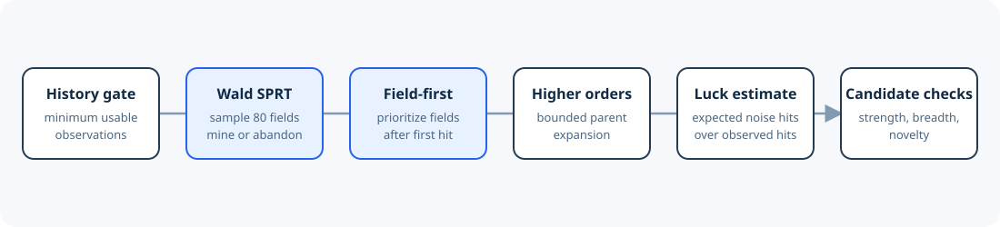

# Adaptive Alpha Scanner

### Statistical experiment design for factor discovery under a fixed simulation budget

Factor mining is often described as a formula-generation problem. I treated it as a **sequential allocation problem** instead: when the search space is effectively unbounded and simulations are scarce, what should be tested next, when should a dataset be abandoned, and how much confidence should each decision carry?

This repository is a sanitized, platform-neutral implementation of that design. It preserves the statistical decisions and orchestration while excluding private field names, production expressions, account data, credentials, platform endpoints, and raw logs.



## The problem

A dataset with `n` fields and `m` templates creates an `n × m` experiment grid. At 200 fields and 56 templates, that is 11,200 simulations; the largest dataset observed would require 372,400. The operating constraint was 4,000 simulations per day and 80 concurrent jobs.

Three empirical facts made uniform search wasteful:

- dataset hit rates varied from 0% to 10%;
- hits clustered much more strongly by field than by operator;
- cells built from the same field were correlated, so simulation outcomes could not all be treated as independent.

The objective was therefore not “run more formulas.” It was: **maximize credible hits per 1,000 simulations, with an explicit error rate at each allocation decision.**

## Statistical design

### 1. Gate datasets with a Wald SPRT

The dataset gate compares `H0: p = 0.5%` with `H1: p = 2%`, bracketing the 1% worth-mining line. The tolerated error rates are 5% for abandoning a good dataset and 10% for retaining a bad one.

Each round samples 80 different fields with one randomly chosen template per field, keeping outcomes close to the independence assumption. A hit adds `log(0.02 / 0.005) = 1.386`; a miss adds `log(0.98 / 0.995) = -0.0152`. The decision boundaries are `+2.25` (mine) and `-2.89` (abandon). A 1,600-simulation cap resolves datasets close to the boundary.

Simulation validation used 3,000 replications at each true hit rate. The resulting keep rates were 4% at a 0.5% true hit rate, 42% at 1%, and 97% at 2%. A zero-hit dataset is abandoned after 240 simulations.

### 2. Allocate within a dataset by field

Once a dataset passes, sampling remains random except for one priority rule: **after a field produces a hit, its remaining templates move to the front of the queue.** Nothing is pruned; only ordering changes.

This choice followed the observed hierarchy of variation. Across earlier datasets, unproven fields produced hits at 1.3-3.1%, while cells from a field that had already hit produced hits at 18.1%. By contrast, a replayed operator-pruning rule saved no simulations and lost no hits: each operator had too few cells to reach the sequential rejection boundary. It was rejected rather than kept for architectural symmetry.

### 3. Bound higher-order search

First-order parents must meet documented Sharpe, Fitness, and position-count thresholds, are ranked by absolute Sharpe, and are capped per field. Second- and third-order variants are generated through abstract wrapper families. Each visit allocates at most 2,000 first-order, 1,000 second-order, and 1,000 third-order simulations.

Selection bias is explicit: selecting top parents admits lucky maxima, and choosing the best of many wrappers inflates winners. The system names these biases; it does not claim to have corrected them.

### 4. Estimate luck, then distinguish strength from novelty

Under a 10-year i.i.d. noise approximation, a noise formula crosses `|Sharpe| ≥ 1` about 0.16% of the time. The exploratory false-discovery estimate is therefore:

```text
expected noise hits / observed hits
= simulations × 0.16% / observed hits
```

This is a diagnostic, not a formal multiple-testing correction. Platform history, sub-universe, concentration, and correlation checks remain separate. The live evidence showed why: correlation with existing production signals became a stronger constraint than noise-driven false discovery.

## What the live evidence changed

The table below contains only category-level names and aggregated results from the design document.

| Dataset | First-order simulations | Hits | Fields hit / touched | Estimated noise FDR | Outcome |
|---|---:|---:|---:|---:|---|
| Analyst | 3,050 | 173 (5.7%) | 20 / 1,950 | Not valid under 10-year model | Rejected by minimum-history gate |
| Options model | 2,000 | 347 (17.4%) | 37 / 380 | ~1% | Mined; paused after 4,000 simulations |
| News | 1,840 | 73 (4.0%) | 11 / 228 | ~4% | In progress |

The field-priority hypothesis held in all three datasets, with a 2-14× hit-rate lift after a field's first hit. The minimum-history assumption failed on the analyst dataset, so a history gate was added before more budget could be spent. In the options-model dataset, 30 of 34 platform checks failed production-correlation review; novelty, not statistical luck, was the binding constraint. One candidate passed all documented checks and was submitted, with Sharpe 1.89, Fitness 1.60, maximum self-correlation 0.47, and maximum production correlation 0.68.

These are research observations from three datasets, not a claim of out-of-sample performance.

## Repository map

```text
scanner/
  statistics.py        Wald SPRT and exploratory noise-FDR estimate
  sampling.py          field-first adaptive batch selection
  formula_factory.py   non-reversible abstract experiment specifications
  pipeline.py          budget, promotion, pause, and resume orchestration
  platform_adapter.py  interface boundary; no auth or endpoints
tests/
  test_statistics.py
  test_sampling.py
  test_pipeline.py
docs/
  STATISTICAL_DESIGN.md
  DESIGN_EVOLUTION.md
results/
  sanitized_summary.csv
```

## Run the tests

```bash
python -m pytest
```

The tests use a deterministic fake adapter. This public repository cannot run production simulations: the private adapter that translates abstract specifications into platform-native expressions is intentionally absent.

## Limitations

- Only three live datasets were available in the design document; conclusions will move with more data.
- The noise model assumes 10 years and i.i.d. daily returns. It must not be applied to shorter histories without adjustment.
- Top-parent and best-wrapper selection bias is identified but not corrected.
- Correlation is observed only after simulation, so budget can still be spent on non-novel signal families.
- Platform history and sub-universe checks are in-sample partitions, not true out-of-sample evidence.

## Disclosure boundary

Dataset categories such as analyst, options model, and news are retained because they are generic research categories. Real field names, alpha expressions, identifiers, credentials, account details, endpoints, region-specific internal group names, and raw run logs are excluded. Synthetic keys in the code are placeholders and cannot be mapped back to the private research environment.

